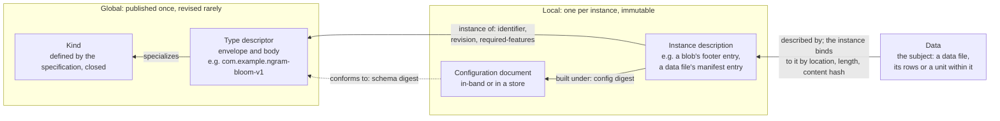

# Versioning Iceberg by Feature

*A companion to the [note on contracts](README.md). It argues that Iceberg's single, table-wide format version fences every feature more heavily than most features need, that this pushes the project toward infrequent releases that bundle unrelated changes, and that the dimensions the note defines are enough to say exactly when an implementation that lacks a feature may still proceed. It also takes up the Puffin proposal's open question on compatible minor revisions of a blob type, which is the same question asked of a smaller structure.*

**Status:** working note, November 11, 2026. Specification text is quoted from apache/iceberg `main` at commit `26c9544`. Statements about other formats are drawn from the [survey of prior art](prior-art.md), which pins its sources.

## The rule today

Iceberg versions its table format with one integer. The specification increments it "when new features are added that will break forward-compatibility", and for every structure that carries it, the obligation on an implementation is the same: "Implementations must throw an exception if a table's version is higher than the supported version." The only way to keep a table readable by older implementations is to leave it at the older version and forgo every feature introduced since.

In the note's terms, the format version is a declaration with the strongest possible setting on every dimension at once:

| Dimension | Setting of the format version |
|---|---|
| Reliance | Required |
| Role | The same for readers, writers and maintenance |
| Scope of refusal | The whole table |
| Earliest point of detection | Table load |
| What it covers | Every feature added since the previous version, as one unit |

The specification's own appendix on version changes reasons more finely than the rule it enforces. Of version 3's defaults it says that "The `write-default` is a forward-compatible change because it is only used at write time", and that "Tables with `initial-default` will be read correctly by older readers if `initial-default` is always null for optional fields." Those are statements about reliance by role and by instance: the write default is ignorable for readers, and the initial default is ignorable for readers whenever its value is null. The analysis is done, in prose, and then discarded by a fence that treats both features as required by everyone.

Version 4 as drafted shows how much the fence bundles. Reading Appendix E of the draft, our assessment of what an implementation that predates each feature would actually do is as follows:

| Version 4 feature | An older reader | An older writer |
|---|---|---|
| Default values that are expressions | Unaffected, since the default is used only at write time | Must refuse, since it cannot evaluate the default ([V7](problems.md#v7-a-writer-that-cannot-evaluate-a-default-has-no-stated-obligation)) |
| Relative paths | Must refuse, since it would resolve locations wrongly | Must refuse |
| Strictly increasing snapshot timestamps | Unaffected | Must refuse, since it could commit a timestamp that violates the rule |
| Equality deletes prohibited | Unaffected | Must refuse, since it could add an equality delete |
| Constraints | Unaffected | Must refuse if any constraint is enforced; unaffected otherwise |
| The `file` type | Must refuse a read that projects a field of the type | Must refuse a write to such a field |

Only one of these needs every reader to refuse the whole table. The rest need writers to refuse, or readers to refuse a projection, and the integer cannot express either.

## What the coarse rule costs

The cost of a version increment is that every implementation that predates it refuses every table that adopts it. That cost is paid per increment, whatever the increment contains, and the community responds in the way the price invites:

- **Features are batched.** If refusal costs the same for one feature as for ten, it is rational to wait for ten. Versions therefore arrive years apart, each a large release.
- **Each release is high stakes, so review is conservative.** A feature that might need revision cannot be shipped and revised in the next minor version, because the next version is years away. A reviewer's safest course is to keep it out.
- **Unrelated timelines become coupled.** A feature that is ready waits for the version, and one that is nearly ready is rushed or misses a whole cycle. The index sync of November 9 met this directly, when the participants chose to keep derived columns for indexes out of the version 4 timeline precisely so that neither piece of work would hold up the other.
- **Upgrading a table is all or nothing.** An operator who wants one feature that only writers need to understand must make the table unreadable by every reader that predates the version, including readers that the feature would never have affected.
- **Features that miss a version go unfenced.** A change that cannot wait for the next version tends to arrive as an optional field with no fence at all. Statistics files and partition statistics files did exactly this in version 1 and 2 tables, and implementations that predate them still drop the fields when they commit and delete the files as orphans ([E25](problems.md#e25-shared-metadata-is-replaced-whole-by-writers-that-understand-only-part-of-it), [E17](problems.md#e17-maintenance-learns-what-to-keep-only-from-snapshot-metadata)). The coarse fence thus produces two outcomes, too much protection or none, and nothing in between.

The last point is the one that most concerns the contracts. A fence that is too expensive to use is not used, and the features it would have protected degrade in ways nobody declared.

## When an implementation that lacks a feature may proceed

The note's dimensions are enough to state the condition exactly. Let a table use a feature F, and let a component C, acting in a role R, not implement F. The role is one of reading, writing (which includes rewriting) and maintenance (expiration, orphan removal, purge, and copying or registering a table). Then **C may proceed without refusing if and only if all of the following hold for R**:

1. **F is declared where C looks before acting.** The table or snapshot metadata names F in a list that C can read without understanding F. If F is not declared, its presence can be discovered only by meeting its structures, and an undeclared feature is treated as the note treats undeclared edges: it is required wherever it could be, and it can be ignorable only where its structures are themselves ignorable by construction.
2. **F's reliance for R is ignorable.** F declares, per role, whether a component lacking it may proceed. The declaration may be conditional on what an operation touches, as a column file is required only by reads that project its fields.
3. **For readers, what F's structures assert survives being ignored.** Every structure F adds is negative, or is derived from data the reader already reads, so that ignoring it changes what the reader can skip but not what it returns. This is the derivation and exclusion-only rule of the Puffin proposal's [Section 6.2](../proposals/puffin-blob-types-and-compaction.md#62-what-a-data-file-scoped-blob-may-assert), generalized from blobs to features.
4. **For writers, F's state survives an unaware writer as valid or detectably invalid.** A writer that does not know F behaves as unaware writers do: it drops fields it cannot parse, drops blobs it cannot interpret, and replaces files whose attachments it does not carry forward. After any of these, each remaining piece of F's state must still be true, or carry a binding (see [Appendix E](README.md#appendix-e-bindings-between-a-file-and-the-metadata-that-tracks-it)) strong enough that an aware reader detects that it is no longer true. A stale claim that cannot be detected as stale makes F required for writers, which is why Lance carries a writer-only flag for its stable row ids: "Older writers could treat its entries as stable row IDs and silently extend coverage".
5. **For maintenance, F's files are safe from C's deletions.** Every file F adds is either reachable through structures C walks or placed where C never deletes, as under a discovery root disjoint from the table location. Otherwise F is required for maintenance, which is the fence Delta's VACUUM protocol check provides on its own.
6. **The degradation is within the operation's tolerance.** Conditions 2 to 5 guarantee that proceeding is never wrong. Whether it is acceptable is the operation's to say, and an audit may refuse a degradation an interactive query accepts.

If any condition fails, C refuses. The refusal's scope is F's scope for R: a field, a data file or a snapshot where F's declaration says so, and the whole table only when F's structures reach it. Its earliest point of detection is wherever the declaration of condition 1 sits, which for a table-level list is table load.

Applied to features Iceberg already has, the condition reproduces what the specification says or implies feature by feature:

| Feature | Reading | Writing | Maintenance |
|---|---|---|---|
| Deletion vectors | Required, since ignoring one returns deleted rows | Required, since a rewrite that ignored one would bring deleted rows back | Required |
| Column files (version 4 draft) | Required for reads that project their fields | Required | Required |
| Statistics files | Ignorable | Ignorable, at the cost of losing them | Required as things stand, since they are reachable only through a field older implementations do not parse |
| Data-file-scoped Puffin blobs, as proposed | Ignorable, by derivation | Ignorable; an unaware rewrite orphans them, and the liveness check detects it | Ignorable under a disjoint discovery root, at the cost of leaked storage |
| Write defaults that are expressions | Ignorable | Required | Ignorable |
| Row lineage | Ignorable, unless the read projects `_row_id` or `_last_updated_sequence_number` | Required, since a writer that moves a row without copying its `_row_id` gives it a new identity silently | Ignorable |
| Relative paths | Required | Required | Required |

Two consequences follow from reading the table by column. Most features need far less than refusal by every reader, so a table that adopts them could stay readable by older engines. And the features that do need refusal by every role are few, which suggests that a whole-table fence is the right tool only for them.

## Minor versions as sets of features

Declared features and integer versions are not alternatives. A sensible arrangement keeps both:

1. **Features are the unit of compatibility.** A table declares the features it uses, each with its reliance per role and its scope, and a component checks the list against what it implements.
2. **Versions are named sets of features.** A major version names a set that every conforming implementation supports, so that "supports version 4" still means something definite. A minor version adds features to that set, so that "4.2" is version 4 plus a known list.
3. **A table's version is derived from the features it uses.** A table that uses only version 4 features, plus one feature from 4.2 that readers may ignore, remains readable by every version 4 reader and writable only by writers that support the feature.
4. **Dependencies between features are declared.** A feature that relies on another, as a feature built on row lineage would, names it, and adopting the first adopts the second.

The whole-table fence remains available, as one setting of one feature's declaration, for the features that need it. What changes is that the price of a feature is the refusal it needs and no more.

### The one increment the mechanism needs

The list of features is itself a structure that older implementations cannot parse, so it cannot be introduced as an optional field: an older writer would drop it, and the next reader would see a table that declares nothing. Introducing the list is therefore a feature that is required of every role, and it needs one last integer increment. The cheapest moment for that is version 4, which is being prepared. If the list rides version 4, later features need not wait for version 5.

The list proposed in the [third version 4 ask](v4-asks.md#3-declaring-what-a-snapshot-depends-on), declaring the data file formats present, the kinds of sidecar required for reading and the discovery roots, is a particular case of the same declaration and should share its mechanism.

## A worked example: row lineage

Row lineage, added in version 3, exercises nearly every field of the envelope, and it is an active concern: as of November 11, 2026 the version 4 draft extends it, Spark's change data capture is being built on it, and its readers are still being corrected. It is worth working through in detail.

**What it is.** Every row has a `_row_id`, unique within the table, and a `_last_updated_sequence_number`. Neither is normally stored: a data file records a `first_row_id`, and a row's id is that value plus its position, while its sequence number is inherited from the file's manifest entry. When a writer moves an existing row to another file, as compaction and copy-on-write updates do, the [specification](https://github.com/apache/iceberg/blob/26c9544ea4744df3d09bb3a9abcefd43997fa595/format/spec.md#row-lineage) says the writer "should" write the two fields under rules within which the row's existing `_row_id` "must be copied into the new data file", and the sequence number is copied too unless the row was modified. Rows of a table upgraded from version 2 have no ids until a later snapshot assigns them, and rows updated through equality deletes are treated as removed and re-added.

**Reliance by role.** Under the safety condition, the feature lands as follows:

1. *Reading* is ignorable unless the read projects one of the two fields. A read that does project them relies on them completely, and a reader that derives them wrongly returns wrong values without an error. Issue [#18543](https://github.com/apache/iceberg/issues/18543) is such a case: the vectorized ORC reader in Spark gives every row of a file its `first_row_id`, ignoring the values the file stores. A per-field condition on reliance, of the kind the envelope allows, describes this exactly.
2. *Writing* is required. A writer that rewrites a file without materializing the ids of the rows it moves assigns them new ids by inheritance, and nothing afterward distinguishes those rows from new ones. Condition 4 fails, since the damage is a claim that cannot be detected as stale. Delta reaches the same classification for its [row tracking](https://github.com/delta-io/delta/blob/ecde102bc37ba916810da1aaa41e9d56ba669544/PROTOCOL.md#row-tracking), which is a writer feature: readers that do not know it are unaffected, and writers that do not know it cannot proceed.
3. *Maintenance* is ignorable, since expiration and orphan removal never move rows.

**Scope and instances.** The scope of a refusal is narrower than the table. For readers it is the two fields. For instances it is the set of snapshots committed after the upgrade, since earlier snapshots carry no ids at all. Delta distinguishes these states explicitly, calling the feature *supported* once writers must assign ids and *enabled* once every row is known to have one, with a backfill between them. Iceberg's specification states the equivalent in prose, and a declaration per instance would let a consumer know which of its snapshots it can rely on.

**Specification versions.** The feature is defined from table format version 3. Pull request [#18526](https://github.com/apache/iceberg/pull/18526) proposes a `_last_updated_timestamp` column defined only from version 4, which under this note would be a revision of row lineage with its own lower bound. Pull request [#18652](https://github.com/apache/iceberg/pull/18652), which makes the Java implementation reject row lineage fields in snapshots of tables below version 3, enforces by hand the first rule of [compatibility with specification versions](#compatibility-with-specification-versions).

**Configuration.** None, declared explicitly. Row ids are assigned by inheritance from values the table already records, and nothing about their meaning depends on a parameter outside the bytes.

**Dependents.** Other features are being built on row lineage, and each would declare it in `depends-on`. Open work on Spark's changelog reads for version 3 tables ([#18317](https://github.com/apache/iceberg/pull/18317)) covers it, and pull request [#18896](https://github.com/apache/iceberg/pull/18896) post-processes it for native change data capture. The secondary index specification [recommends](https://github.com/apache/iceberg/blob/42f4b128f69fb250919f55d2e354e2ec0028229d/format/index-spec.md#recording-the-source-row-location) `_row_id` among its identity columns, noting that it "stays valid when a data file is rewritten, but has to be resolved to a location when reading". An index whose entries carry row ids instead of file and position would survive compaction, which bears directly on [V14](problems.md#v14-each-rewrite-disables-a-snapshot-pinned-index-until-it-is-rebuilt), but only if every writer that compacts the table preserves the ids. That is condition 4 again: such an index inherits row lineage's reliance for writers, and its correctness rests on a rule the specification states as "should".

The example suggests one change to the specification, independent of the rest of this note. The rules for writers that move rows are written as a SHOULD around a MUST, while every consumer of row lineage relies on them as a MUST. Stating them as a MUST for version 3 and later writers, with the cases in which ids may be reassigned listed explicitly, would make the reliance consumers already place on them a requirement.

## Features in general, kinds in particular

The Puffin proposal designs a namespace and a descriptor for blob types, and the contracts note proposes [the same pair](README.md#what-could-be-shared) for data file formats. A list of table features needs both a third time, and format extensions, kinds of sidecar and functions in stored expressions would each need them again. Specifying the pair once, over features in general, and treating each family as a specialization costs less than specifying it five times and keeping the copies aligned.

### One identifier space

The grammar of the Puffin proposal's [Section 4.1](../proposals/puffin-blob-types-and-compaction.md#41-identifier-syntax) names any feature, with the same rules: an identifier without a namespace is reserved for the Iceberg specifications, every other identifier carries a namespace its author controls, and an incompatible revision is a new major version and so a different feature. `relative-paths-v1` would be a feature the specification defines, `com.example.vortex-v1` a data file format a third party defines, and `com.example.ngram-bloom-v1` a blob type. Identifiers of different kinds share one space, so a name means one thing wherever it appears.

### One envelope

Every feature has a descriptor with a common envelope and a body whose schema depends on the feature's kind:

| Envelope field | Meaning |
|---|---|
| `id` | The identifier |
| `kind` | Which family the feature belongs to, from a list the specification defines |
| `definition` | The normative description |
| `reliance` | For each of reading, writing and maintenance, whether a component lacking the feature may proceed, with any condition (the fields a read projects, the files an operation touches) |
| `scope` | What a refusal covers: a unit, a data file, a snapshot or the table |
| `depends-on` | Features that adopting this one adopts |
| `spec-versions` | For each specification the feature touches, the range of versions it is defined against, and the named versions whose sets include it |
| `config` | Required. Either the explicit value `none`, or the feature's configuration contract: a schema and its digest, and which parameters play the roles of evaluation, composition and provenance |
| `body-schema-digest` | The digest of the schema the kind-specific body conforms to |

The envelope is everything a component needs in order to decide whether to proceed without understanding the feature, which is the purpose of the safety condition above. The body is everything a component needs in order to use it, and only components that implement the feature read it.

> **TODO (declarations as expressions).** Reliance, scope and the ranges of `spec-versions` are written above as enumerations with a few parameters, and they can begin life that way: `ignorable` or `required`, per role, optionally qualified by a list of field ids, a kind of operation or a version range. They will probably not stay that way. Each is already a predicate over the properties of an operation (its role, the fields it projects, the files it touches, the table's version, its tolerance), and the qualifications that accumulate on an enumeration are a predicate language arriving one special case at a time, as the note's discussion [on structure](README.md#on-structure) anticipates. The eventual form is an expression over the fixed, versioned vocabulary of operation properties that the note proposes passing [down the stack](README.md#requirements-flow-down-verdicts-flow-up), evaluated by the safety condition. Three constraints carry over from what the note asks of other stored expressions. Such an expression reads nothing but the declared properties of the operation, so that every component evaluates it identically. Its language is itself a feature, with its own identifier and `spec-versions`, so that a newer vocabulary is detectable. And a component that cannot evaluate a declaration, because it meets an unknown operator or property, treats the feature as required for the role in question, which keeps an older binary on the side of refusal. The enumerated form should be chosen so that each of its values is a constant of the later language, and a declaration written today then remains valid when the language arrives.

#### Compatibility with specification versions

A feature is written against particular versions of particular specifications, and its descriptor says which, explicitly, instead of leaving a reader to infer it from the date it was registered. `spec-versions` maps the name of each specification the feature touches (the table specification, Puffin, the expressions specification, the REST catalog specification) to three things:

1. **A lower bound**, the earliest version under which the feature is defined. A feature that relies on deletion vectors or row lineage is defined from table format version 3, and one that relies on relative paths from version 4. The Puffin proposal's direction on positional invalidation ([Section 14.18](../proposals/puffin-blob-types-and-compaction.md#1418-positional-invalidation)) is an example, since it is sound only where a data file has at most one deletion vector.
2. **An upper bound, where one exists.** A later version can prohibit what a feature depends on, as version 4 prohibits equality deletes, or absorb the feature into its own definition, after which declaring the feature separately is meaningless. Most features have no upper bound when they are written; a bound is added by revising the descriptor once a version that ends the feature is published.
3. **Membership in named versions.** When a minor or major version adopts a feature into its set, the feature's descriptor records it, so that "supports version 4.2" can be expanded into features mechanically and a feature's history of adoption can be read from its descriptor.

The reliance declarations of the envelope may also differ by version, and `spec-versions` is where they are keyed when they do. Statistics files are the case in point: reachable only through a field that implementations predating them do not parse, they are required for maintenance at the versions where that exposure exists, and they would be ignorable at a version whose maintenance is obliged to walk them.

Three rules follow:

1. A writer MUST NOT use a feature in a table whose format version lies outside the feature's declared range for the table specification, and likewise for the other specifications it touches, such as the Puffin version of the file a blob is written to.
2. A component that meets a feature declared outside the range for the version it is reading treats the feature as unrecognized, which under the safety condition means refusal wherever the feature is not ignorable.
3. Upgrading a table's format version re-checks every feature the table declares against the new version, and the upgrade fails, or the feature is removed first, where a feature's range ends below the new version.

The registry can check the first rule's precondition when a feature is registered: a descriptor whose range names a version that does not exist, or whose dependencies are defined only outside its range, is malformed.

#### Configuration

A type identifier fixes the format of a structure but not the parameters it was built under, and some of those parameters are needed to interpret it. The Puffin proposal's [Section 7](../proposals/puffin-blob-types-and-compaction.md#7-build-configurations) was written for blob types, where an n-gram filter probed under the wrong normalization excludes files that hold matching rows. The note's [configuration paranoia](README.md#configuration-paranoia) finds the same hazard in data file formats, in timestamps whose adjustment to UTC is unrecorded and dates that need a calendar rebase only a later writer flags ([E27](problems.md#e27-parameters-that-change-what-the-bytes-mean-are-kept-outside-the-bytes)). Default values that are expressions meet it as the session time zone and clock they were evaluated under ([V8](problems.md#v8-defaults-depend-on-context-that-nothing-records)), and format extensions and sidecars will meet it as encoding parameters. It is therefore a property of features in general, and the envelope carries it.

Every feature's descriptor MUST declare its susceptibility in `config`, and a descriptor without the field is malformed. Most features will declare `none`, and that is the point of requiring it: an explicit `none` is a claim a reviewer can check and a later revision cannot quietly contradict, whereas an absent field leaves every reader to assume. A feature that declares a contract inherits the rules of the Puffin proposal's Section 7, generalized from blobs:

1. **Classified parameters.** The contract names each parameter's roles: *evaluation*, needed to interpret the structure correctly; *composition*, which must agree for two instances to be combined, as by a compaction that concatenates data files or merges blobs; and *provenance*, recorded so that people and tools can find instances built a particular way.
2. **Configurations identified by digest.** A configuration is identified by the digest of its canonical form, prefixed by the digest of the feature's configuration schema, so that two features whose documents coincide never share an identity.
3. **Recorded per instance.** Every instance of a feature with evaluation parameters records the digest of the configuration it was built under, in the place its kind defines: a blob's properties, a data file's per-instance description, a sidecar's reference.
4. **Resolve or decline.** A component that cannot resolve and verify an instance's configuration treats the instance as not understood, which under the safety condition means declining it where the feature is ignorable and refusing where it is required. No instance is interpreted under an assumed configuration.
5. **Revocation by digest.** A configuration found to be defective is revoked in table metadata, and every instance built under it goes out of service with one commit. The revocation list for writer versions proposed for [E26](problems.md#e26-statistics-from-a-defective-writer-are-trusted-indefinitely) is this rule applied to provenance.
6. **No late evaluation parameters.** A feature MUST NOT acquire evaluation parameters after its first published version. One that needs them takes a new major version, so that implementations which know the old version, and would interpret instances without a configuration, never meet an instance that needs one. This is the rule of the proposal's [Section 11.4](../proposals/puffin-blob-types-and-compaction.md#114-configuration-references), and it is why `none` must be declared deliberately: it is a promise about every future revision within the major version.

The contract's schema and digest are part of the descriptor, so they are compiled into implementations that link features at build time, and the comparison an implementation makes against a resolved configuration is a set difference over keys.

### Type descriptors and instance descriptions

Two kinds of metadata are in play, and the note has so far called both "descriptors". They differ in subject, in lifetime and in who can be expected to read them, and keeping them apart settles several questions that are otherwise muddled.

A **type descriptor** is metadata about a feature: one document per identifier, published with the feature's definition, listed in the registry and compiled into implementations. It changes rarely, only by compatible revision within a major version, and almost always resolves, since an implementation of the feature carries it. It says nothing about any particular table, file or blob.

An **instance description** is metadata about one use of a feature, in the scope the instance declares or the subject it sits beside: a blob, a data file, a sidecar, a table. It is written with the instance, lives exactly as long as the instance, and is the thing a reader actually meets. It must say which type it is an instance of, and carry everything about the instance that the type cannot know.

| | Type descriptor | Instance description |
|---|---|---|
| Subject | A feature | One instance: a blob, a data file, a sidecar, a table's use of a feature |
| Written | When the feature is defined or revised | With the instance, in the same commit |
| Changes | Rarely, by compatible revision; never within a revision | Never, for the life of the instance |
| Resolvable | Almost always, from the implementation or the registry | Always, since a reader holding the instance holds it |
| Carries | Envelope and body: reliance, scope, `spec-versions`, `config` contract, kind-specific rules | A reference to the type, the binding to its subject, a configuration reference, provenance, and any strengthening of the type's reliance |

The two sit between the data and the kind, each referring outward from the instance:

A reader starts from the data on the right and meets its instance description first. From there it resolves the type, which it usually already holds, and the configuration, which it must resolve or decline. Then it checks the instance's binding against the data before trusting anything the instance says.

An instance description carries, at a minimum:

1. **A reference to its type**: the full identifier, the revision written under, and the `required-features` a reader must understand. The revision may be pinned further by the digest of the type descriptor it was written against.
2. **Its binding to its subject**, memorialized as [Appendix E](README.md#appendix-e-bindings-between-a-file-and-the-metadata-that-tracks-it) requires: location, length and, wherever one is available, a content hash, so that a reader can tell that the subject is the one the instance was made for.
3. **A configuration reference**, the digest of the configuration it was built under, wherever the type's `config` contract declares evaluation parameters.
4. **Provenance**: the identity and version of the writer, which is what revocation by writer version ([E26](problems.md#e26-statistics-from-a-defective-writer-are-trusted-indefinitely)) needs.
5. **Any strengthening of reliance or scope** for this instance, never a weakening, by the rule the note gives for [sidecars](README.md#type-layer-and-instance-layer).

One exception to the separation is deliberate. A component that has never seen a feature cannot resolve its type descriptor, and a compiled binary should not try to fetch one in production. So the instance descriptions that a component must act on before understanding the feature, the entries in a table's list of features above all, carry a copy of the envelope fields the safety condition needs: reliance by role, scope and `spec-versions`. That copy is a cache of the type descriptor for the one decision of whether to proceed, never a substitute for it, and where the two disagree the stronger declaration governs, as the [rules for compiled-in implementations](#implementations-without-run-time-discovery) say.

Existing structures already sort themselves this way, without the vocabulary:

| Kind | Type descriptor | Instance description today |
|---|---|---|
| Puffin blob | Proposed (Puffin proposal, Section 5) | The blob's footer entry: `type`, `fields`, `properties`, offset and length |
| Data file format | Proposed ([format descriptor](README.md#a-global-versioned-type-descriptor-and-a-per-instance-description)) | The manifest entry, which records only `file_format`, location and length; the format extensions, writer identity and content hash are missing |
| Deletion vector | Implicit in the specification | The delete file's manifest entry, with `referenced_data_file`, offset and size |
| Table feature | Proposed above | The format version alone today; an entry in the table's list of features under this note |

The word "manifest" is avoided for the second kind on purpose. Iceberg's manifests are one container in which instance descriptions live, for data and delete files, and the Puffin footer is another, so naming the concept after one container would mislead about the rest.

The levels stop there. Above the type descriptor sits only the kind, which the specification defines and keeps closed, so there are two levels anyone outside the project writes, and one the project owns.

### Kinds as dependent specializations

A kind does two things: it defines the schema of the body, and it constrains the envelope. The second is where the note's constraints between dimensions live. A kind can fix a dimension for all its members, or forbid some of its values, so that a member's descriptor cannot claim what its kind cannot deliver:

| Kind | Body | Constraint on the envelope |
|---|---|---|
| Table feature | Usually empty; the definition is the substance | None beyond the envelope's own |
| Data file format | Read and write tiers, type mappings with ranges, addressable units, whether it is splittable ([format descriptor](README.md#a-global-versioned-type-descriptor-and-a-per-instance-description)) | Required for reading and writing the data files in it, with data-file scope |
| Format extension, such as an encoding | What it changes in the format's decoding | Depends on its format; required for reading with data-file or unit scope |
| Sidecar kind | Reference, assertion polarity, carry-forward ([Appendix D](README.md#appendix-d-sidecars)) | A discovered sidecar kind must be ignorable for reading; an instance may strengthen reliance and never weaken it |
| Puffin blob type | The descriptor of the proposal's [Section 5](../proposals/puffin-blob-types-and-compaction.md#5-blob-type-descriptors) | Ignorable in every role, fixed by the derivation rule |
| Function in a stored expression | What it reads from its evaluation context and what it can do ([classifying expressions](README.md#classifying-expressions-instead-of-special-casing-them)) | Required for writers that evaluate it; for readers, as the expression's use decides |

Some consequences fall out of the arrangement without further rules:

1. **Only features that are not ignorable somewhere need to be listed in a table.** A component that meets an ignorable feature can decline it on the spot, so listing it buys nothing for correctness. Blob types, being ignorable by construction, therefore never need a table's list. Data file formats and their extensions always do, and listing them is what moves the refusal of [E16](problems.md#e16-unsupported-formats-and-features-are-discovered-mid-scan) and [E28](problems.md#e28-a-reader-cannot-tell-whether-it-can-decode-a-data-file-before-opening-it) from mid-scan to table load.
2. **Registries can be one file with a kind column, or one per kind.** Either way the review rule is the same: a well-formed identifier, a plausible claim to its namespace, and a descriptor whose envelope satisfies its kind's constraints.
3. **The set of kinds is closed, and defined by the specification.** A new kind brings a new body schema and new constraints, and those are specification work. Opening the set of kinds to third parties is a further step that we do not propose.

The risk in this section is building an ontology before anyone needs one. The envelope is small, and kinds can be specified one at a time as each family is taken up. Table features and blob types are enough to show that the shape works, and file formats are the first kind for which a third party is already waiting. The note's [sidecars as a waypoint](README.md#sidecars-as-a-waypoint) proposed one envelope for kinds of sidecar. This section takes that proposal one level up, to features of every kind.

## Implementations without run-time discovery

Iceberg's implementations in Rust, C++ and Go link what they support at build time, and the Puffin proposal's [Section 9.4](../proposals/puffin-blob-types-and-compaction.md#94-implementations-without-run-time-discovery) sets out rules for blob types compiled in that way. The same rules extend to features of every kind, and the extension makes one requirement on the table that the rest of this note has left implicit.

A compiled-in implementation meets two kinds of feature: those it was built with, whose descriptors it carries, and those it has never seen, whose descriptors it cannot fetch, since a binary in production should not depend on reaching a registry. For the second kind it can decide only from what the table says. Each entry in a table's list of features therefore carries the envelope fields the safety condition needs, copied from the descriptor when the feature is adopted: the identifier, the reliance for each role with its conditions, the scope of refusal, and the specification versions. An entry that named a feature without these would leave an implementation that does not know it no choice but to refuse.

The rules for a compiled-in implementation are then:

1. **Feature descriptors are compiled in.** The implementation carries the full descriptor, envelope and body, of every feature it implements, including the `spec-versions` and the configuration schema it was built against, and exposes the set at run time, so that what a binary supports can be audited from the binary.
2. **The implemented specification versions are compiled in.** The implementation records exactly which versions of each specification it implements, minor versions included, and never infers support for one version from support for another.
3. **Every table is checked before use.** On loading a table, the implementation compares the table's declared format version and each declared feature with its compiled-in set, and evaluates the safety condition for the role it is about to act in. A feature it does not implement is decided from the table's entry alone. A feature it implements but whose declared range excludes the table's version, by the compiled-in descriptor, is treated as unknown.
4. **The stronger declaration governs.** Where the table's entry and the compiled-in descriptor disagree about reliance, scope or range, the implementation obeys whichever is more restrictive. The compiled-in copy is never weakened by a newer declaration, and a newer declaration that strengthens a requirement is obeyed by an older binary.
5. **Structures are checked as they are met.** A blob's `required-features`, a data file's format extensions and any other per-instance declaration are compared with the compiled-in set when the structure is read, and an unrecognized entry leads to declining the structure where it is ignorable and refusing where it is not.
6. **Every refusal and every declined structure is reported** with the feature responsible, so that an operator can tell a binary that needs rebuilding from a table that needs repair.

The Java library applies the same checks. Discovery at run time changes when the set of implemented features is fixed, which is when a class path is assembled instead of when a binary is linked, and nothing about what is checked.

## Within Puffin: compatible revisions of a blob type

The Puffin proposal puts a blob type's major version in its identifier and leaves compatible evolution to the descriptor, with an open question ([Section 14.14](../proposals/puffin-blob-types-and-compaction.md#1414-descriptor-evolution), and the TODO under [Section 4.1](../proposals/puffin-blob-types-and-compaction.md#41-identifier-syntax)) about how a reader is to know what a newer writer may have added. The condition above answers it, and more cheaply than at table level, because a blob is ignorable by construction.

Within one major version, a type's definition can be revised. Each revision may add properties, payload sections or descriptor fields, and each addition falls into one of two kinds:

- **Ignorable additions**, which a reader of an earlier revision can disregard and still evaluate the blob correctly, such as an optional property that only refines selectivity.
- **Additions that must be understood**, without which a reader would draw a wrong conclusion from the blob, such as a new encoding of part of the payload.

The first kind needs nothing new. For the second, we would propose a reserved property, `required-features`, holding a list of feature identifiers, in the grammar above and namespaced under the type. A reader that finds an unrecognized name in that list declines the blob. Because declining a blob costs only index coverage, this is the critical bit of X.509 extensions and CoAP options at no correctness cost, and it lets a type evolve within a major version for every change except the one the proposal already reserves for a new major version, a relaxation of an obligation the descriptor states.

A writer would also record the revision it wrote under, as a `type-revision` property, for provenance. Nothing would depend on it for correctness, since the list of required features carries that.

## What other formats do

The [survey of prior art](prior-art.md#e11-ignoring-as-the-default-or-as-the-exception) found the full range:

- **Delta** declares capabilities as named table features in its protocol action, separately for readers and for writers, and checks them when a snapshot loads. Readers and writers "must not ignore table features", while unrecognized fields "are never required" and must be ignored. Its VACUUM protocol check is a feature whose only purpose is to make older maintenance refuse. That is a fence for one role alone, the case condition 5 describes. Delta's drop-feature command rewrites a table until a feature can be removed, though its protocol text says features are never removed, an inconsistency the survey records.
- **Lance** keeps separate reader and writer feature bitmaps, and either side returns an unsupported error on a flag it does not know.
- **Hudi** fences by an integer table version, all or nothing, with an unknown version failing at load.

Delta's arrangement is closest to the one proposed here. What the condition adds is the reason a feature lands where it does, stated in terms a reviewer can check: a feature is a writer feature because condition 4 fails for writers and holds for readers, not because its authors judged it so.

## Costs

The arrangement is not free, and four costs are worth weighing:

1. **A larger support matrix.** Implementations can support different subsets, and tests have to cover the combinations that occur. Named versions bound this, since most implementations will support whole versions and only some will run ahead.
2. **Feature interactions.** Two features that are each safe to ignore may not be safe to ignore together. Declared dependencies cover the cases foreseen, and each new feature's review has to ask about the rest.
3. **Removal.** A feature once used is hard to remove, and Delta's experience shows that removal means rewriting the data that uses it. Removal could be specified as its own operation, with a declared end state.
4. **Stale declarations.** A writer that adopts a feature without declaring it defeats the mechanism. The list being required for writers, which is the point of introducing it under the last increment, is the guard.

## Candidate requirements

1. Table metadata carries a list of the features a table uses, each declaring its reliance for reading, writing and maintenance, and the scope over which a refusal applies.
2. A component that meets an undeclared or unrecognized feature that is required for its role refuses, at the earliest point the declaration allows, and says which feature it lacks.
3. A feature may declare itself ignorable for a role only if it meets conditions 3 to 5 above for that role, and its specification text shows why.
4. Major and minor versions are named sets of features, and a table's version is derived from the features it uses.
5. The list of features is introduced under one integer increment, preferably version 4, after which a feature that needs refusal by only some roles is added without one.
6. Puffin blob types reserve `required-features`, and a reader declines a blob that lists a feature it does not recognize.
7. Features of every kind share one identifier grammar and one descriptor envelope, and each kind the specification defines gives the schema of its body and the constraints it places on the envelope.
8. Every feature's descriptor declares, for each specification it touches, the range of versions it is defined against and the named versions that include it, and writers, readers and table upgrades check it.
9. Every feature's descriptor declares its configuration contract or, explicitly, that it has none; instances of a feature with evaluation parameters record the digest of their configuration, and a component that cannot resolve it declines or refuses as the feature's reliance requires.

## Open questions

1. Whether the feature list belongs in table metadata, in snapshot metadata, or in both, given that branches can differ in what they use.
2. Whether an implementation should be allowed to declare support for a minor version partially, and how that would be reported.
3. Whether the condition's verdict for each existing version 4 feature, as tabulated above, matches what the feature's authors intend; the table is our reading, not theirs.
4. How a catalog that plans scans on a client's behalf reports a refusal caused by a feature the client lacks.
