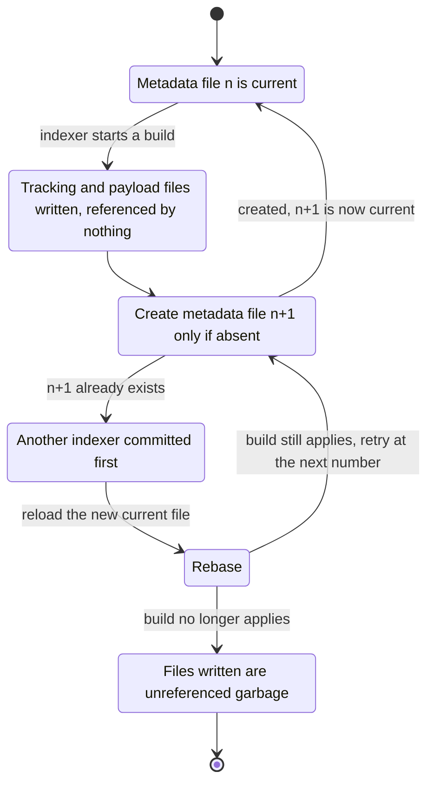
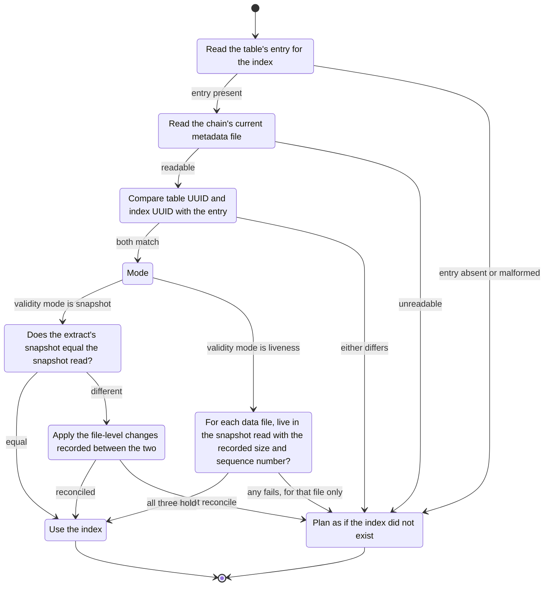
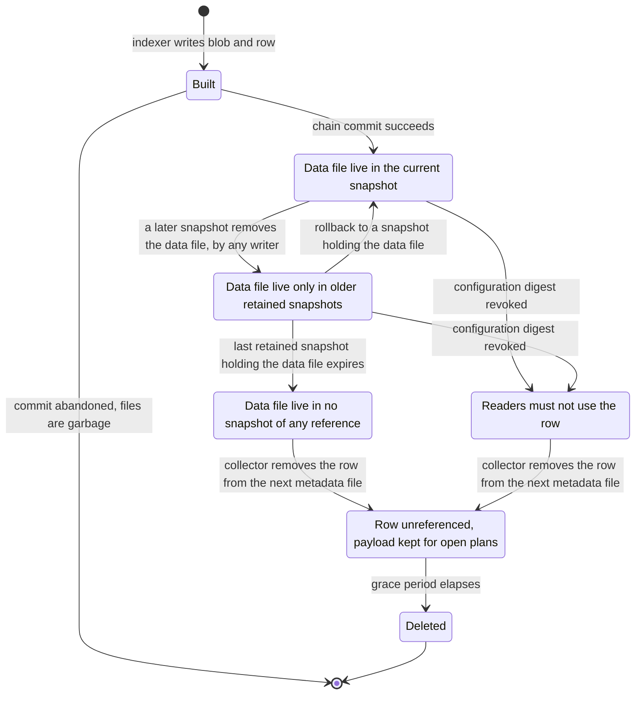
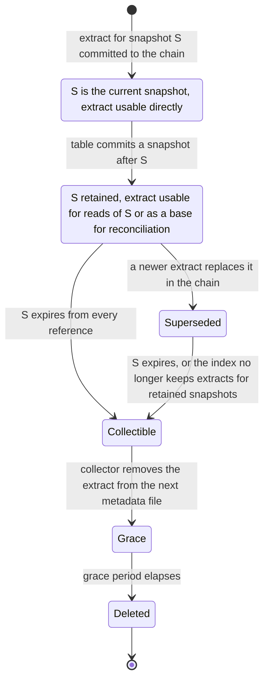
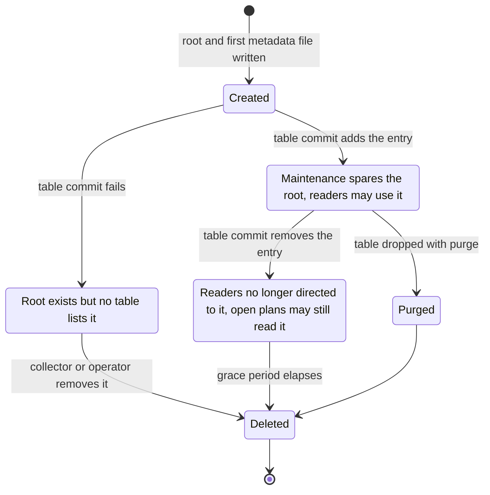

# A Decoupled Metadata Mechanism for Iceberg Indexes

*A working note on a metadata mechanism that could serve both the secondary index specification under review in apache/iceberg [pull request 16961](https://github.com/apache/iceberg/pull/16961) and the data-file-scoped blobs of [Pluggable Puffin Blob Types and a Compaction-Aware Blob Lifecycle](puffin-blob-types-and-compaction.md).*

**Status:** working note supporting Section 14.2 of [the proposal](puffin-blob-types-and-compaction.md), which summarizes it; the state diagrams and the objections are kept here. The identifiers and field names below are placeholders. The companion note on [index reachability](index-reachability.md) sets out the maintenance hazard that motivates the mechanism and the evidence for it.

## Where the two designs already agree

Both designs keep index state out of table metadata, and for the same reason. The index specification commits an index's metadata by an atomic swap of its own, located through the catalog, so that building or refreshing an index never contends with the table's writers. Section 12.3 of our proposal concedes that this is the better choice, and Section 6.5 now keeps index manifests in a sidecar with a commit chain of its own. Both designs then leave the same gap. Table maintenance that knows nothing of indexes either deletes their files, if they lie beneath the table location, or leaks them, if they do not. Neither design gives a table any way to tell its maintenance that an index exists.

Beyond that the designs differ in ways that matter for a shared mechanism, and the differences are fewer than the vocabulary suggests.

| Concern | Index specification (PR 16961) | Data-file-scoped blobs (Section 6.5) |
|---|---|---|
| Unit of index state | an extract, the complete state of one index for one snapshot | an index manifest row, one blob for one data file |
| Validity | the extract's snapshot; positive inference requires exact agreement with the rows read | liveness of the referenced data file in the snapshot read; negative by default |
| Tracking layer | tracking file over region files (Parquet, Avro or ORC) | index manifest over Puffin blobs |
| Commit authority | the catalog, through the REST endpoints of PR 16963 | conditional create-if-absent on the object store |
| Discovery | the catalog | a table property naming the index root |
| Identity binding | the index's catalog identifier and its source table | the table UUID recorded in the sidecar |
| Garbage collection | unspecified at the table level; the extracts list is the only reachability root for index files | the sidecar's own collector, with a grace period |

Everything above the tracking layer is common machinery, and everything at or below it is specific to the kind of index. That split is where the mechanism should be cut.

## The mechanism

The mechanism has three layers, and only the first touches table metadata.

**The table's list of index roots.** A version 4 table carries, in table metadata, a list of the indexes that maintenance must know about. Each entry records an index UUID, the location of the index's root, and the index's commit authority. The list changes when an index is created or dropped and at no other time, so the contention it introduces is one table commit per index lifetime. A table at an earlier version records the same entries in a table property, which implementations that predate the mechanism carry through their commits unchanged and otherwise ignore.

**The index metadata chain.** Each index has its own chain of JSON metadata files beneath its root, in the shape the index specification already defines: a current metadata file, a metadata log, and the definition of the index. The common envelope adds the fields that make the chain checkable against its table:

* the UUID of the source table, which a reader compares with the table's own before using anything in the chain;
* the index UUID, matching the table's entry;
* a *validity mode*, either `snapshot` or `liveness`, which tells a reader and a collector what the index's state is bound to;
* the list of current states, each pointing to type-specific tracking files. For `snapshot` mode these are the specification's extracts, each naming its snapshot. For `liveness` mode there is a single current state whose tracking files are index manifests.

**Type-specific tracking.** Below the envelope each index type defines its own files: tracking files and region files for the scalar index, and index manifests and Puffin files for a file filter index. The envelope does not interpret them, and a reader that does not implement a type ignores the whole index, which is safe for both designs because neither is consulted to establish what rows exist.

## Commit authority

A chain must have exactly one authority that decides which metadata file is current, and two authorities for one chain is the most direct route to a split brain. The table's entry therefore declares the authority explicitly, and readers and writers refuse a chain whose declared authority they cannot honor.

Two authorities are worth defining. The first is the catalog, as in the index specification, where commits and discovery both go through the REST endpoints and the root's location is advisory to everything but maintenance. The second is the object store, where a commit is a conditional create of the next numbered metadata file. The second exists for catalogs that will not implement index endpoints, and it is the arrangement Section 6.5 of the proposal describes.

The community has some reason to resist the object-store authority. Iceberg's filesystem catalog fell out of favor on object stores because they lacked an atomic rename. Conditional writes on the major object stores remove that objection for a chain whose files are created and never renamed, but the history will be raised, and the case should be made on the specifics of create-if-absent rather than by analogy to the filesystem catalog.

The object-store authority commits as follows. Files written before the conditional create are unreferenced until it succeeds, so a failed or abandoned attempt leaves garbage and nothing a reader can see.

## Catalog neutrality

The index specification puts both discovery and commits through REST catalog endpoints, which would make the REST catalog load-bearing for anyone who wants an index. Iceberg has been moving in that direction. Credential vending and server-side scan planning, for example, are defined only for it. A large share of deployments, however, still run on catalogs that do nothing but swap a pointer to table metadata: the Hive Metastore, AWS Glue and JDBC catalogs among them. An index mechanism that only the REST catalog can host would leave those tables without indexes. It would also make the catalog part of the correctness story for every table that has one.

We therefore propose that the mechanism function, in full, with a catalog that knows nothing of indexes, and that it treat the REST endpoints as an optional authority and accelerator. The design above already allows that, and the property should be stated as a principle rather than left as a consequence:

* The list of index roots lives in table metadata, which every catalog stores and swaps, so maintenance and readers discover indexes without asking the catalog anything.
* An index's commit authority is declared per index. The object-store authority needs only conditional writes, and the catalog authority is available where the catalog offers it.
* Correctness never depends on the catalog. The reader's rule checks every index against table metadata, so a catalog that serves a stale or wrong index costs performance alone.
* A REST catalog may still add value: it may vend credentials that reach the listed roots, serve the list in its table response, and commit an index under its own authority with whatever access control it applies.

The cost of neutrality falls on the object-store authority, which then becomes the default rather than a fallback and must stand up to the scrutiny described under commit authority. Credential scoping turns out to be a narrower problem than it first appears. Deployments without a REST catalog usually give engines storage credentials of their own rather than vended ones, so an index root outside the table location is reachable wherever the engine's credentials reach. The problem is confined to vending catalogs, which are also the catalogs able to solve it.

## The reader's rule

The mechanism decouples index commits from table commits, and the price is that nothing guarantees an index is current. Readers therefore treat an index as a claim to be checked against table metadata, never as a description to be trusted. Before using any state from a chain, a reader confirms that the chain's table UUID and index UUID match the table's entry. It then confirms validity by the chain's mode. In `snapshot` mode the extract's snapshot must be the one being read, or the reader must reconcile the difference using the file-level changes Iceberg records, as the specification already allows. In `liveness` mode every referenced data file must be live in the snapshot being read, with the size and data sequence number the index recorded. Any failure, including an unreadable root, counts as the absence of an index. Under this rule a stale or damaged index costs performance and nothing else, whichever mode it uses.

## The maintenance contract

The list of index roots exists so that maintenance written for version 4 can keep four obligations.

* **Orphan removal** treats every file beneath a listed root as reachable. It neither lists nor deletes there, and it leaves collection within the root to the index.
* **Snapshot expiration** does not reach into an index root. After expiring snapshots it may notify, or invoke, each listed index's collector, and the mechanism defines what a collector may delete. In `snapshot` mode that is an extract whose snapshot is no longer retained by any reference. In `liveness` mode it is a row whose data file is live in no retained snapshot. In both modes the collector deletes only after a grace period longer than any plan a reader may hold open.
* **Dropping a table with purge** removes every listed root, or, for a catalog authority, asks the catalog to drop each index.
* **Registering, copying or replicating a table** must say what happens to its index roots, and the default should be to omit them. A copy that keeps the source's table UUID but not its data file locations would fail the liveness check harmlessly, but a copy that kept both would share the source's index under two authorities, which is the split brain again.

The contract leaves index internals to the index. Table maintenance learns only where each index is and whose job it is to clean it, which is enough to stop it from deleting index files and enough to tell it what to purge.

The two modes give a unit of index state different lifecycles, and the collector's rule follows from them. In `liveness` mode the unit is an index manifest row. Whether a reader may use it depends on the snapshot being read, so the states below describe the row's standing among the table's retained snapshots rather than its validity for any one reader. A rollback can return a row to use, which is why a collector waits for the last retaining snapshot to expire rather than acting when a file first leaves the current snapshot.

In `snapshot` mode the unit is an extract, and its lifecycle is bound to one snapshot rather than to many files.

An index root has a lifecycle of its own, and the order of its steps matters. The root is written before the table commit that lists it, so a failed table commit leaves an unlisted root, which orphan removal's age threshold protects only for as long as the threshold lasts. Dropping an index removes the entry before the root, so that maintenance stops treating the root as reachable only after readers have stopped being directed to it.

## What each design would change

The index specification would gain the table's list of roots, the validity mode with a second value, and the maintenance contract. Its catalog commit protocol, extracts, tracking files and region files are unchanged, and its worked example could keep its index root beneath the table location once version 4 orphan removal honors the list. The file filter index suggested in Section 12.3 of our proposal becomes an ordinary index type under the specification, in `liveness` mode, without the specification having to adopt Puffin for region files.

Our proposal would replace the single sidecar property of Section 6.5 with an entry in the list (or in its pre-version-4 property form), adopt the specification's envelope for the sidecar's metadata chain, and declare the object store as the chain's authority where the catalog offers no index endpoints. Section 6.5's reader checks become the `liveness` half of the reader's rule. The disjointness rule of Section 11.3 remains necessary only for tables below version 4.

## Objections

**A list in table metadata reintroduces coupling.** It does, once per index lifetime, which is the cost of telling maintenance anything at all. The alternative of locating indexes only through the catalog leaves maintenance that does not consult the catalog for indexes, which today is all of it, unaware.

**Two validity modes complicate the specification.** They do, and they could be avoided by forcing file-scoped state into snapshot-pinned extracts. That would make every append invalidate a file filter index that the append did not affect, and would bring the reference implementation's refusal to use an index across non-append snapshots to an index type that has no need of it. The modes describe a real difference in what the two kinds of index assert, which Section 12.2 of the proposal sets out.

**Delegating collection to the index means an index with no running collector leaks.** That is true, and it is the same leak the sidecar already accepts. Purge bounds it, because a dropped table takes its listed roots with it. An optional hook by which expiration invokes a collector shipped with the index type's implementation would bound it further, at the cost of running index code inside table maintenance.

**Credential scoping is unresolved.** Catalogs that vend storage credentials scope them to locations they know. With the list in table metadata a catalog can include every listed root, but nothing obliges it to, and a reader without access falls back to planning without the index. That is safe and should probably be stated as a SHOULD for catalogs.

## Open questions

* Whether the index specification's authors would accept a second validity mode, which is the question Section 14.3 of the proposal already asks in a narrower form.
* Whether the list of roots belongs in table metadata or in the catalog's table response, and whether a REST catalog may serve it without the table metadata carrying it.
* Whether the object-store authority should be part of the specification or left to implementations, given the history of the filesystem catalog. Catalog neutrality argues for the specification, since otherwise tables in non-REST catalogs have no interoperable way to commit an index.
* How the list interacts with branches and tags, and whether an index may be scoped to a branch.
* Whether expiration should merely tolerate index collectors or be obliged to invoke them.
