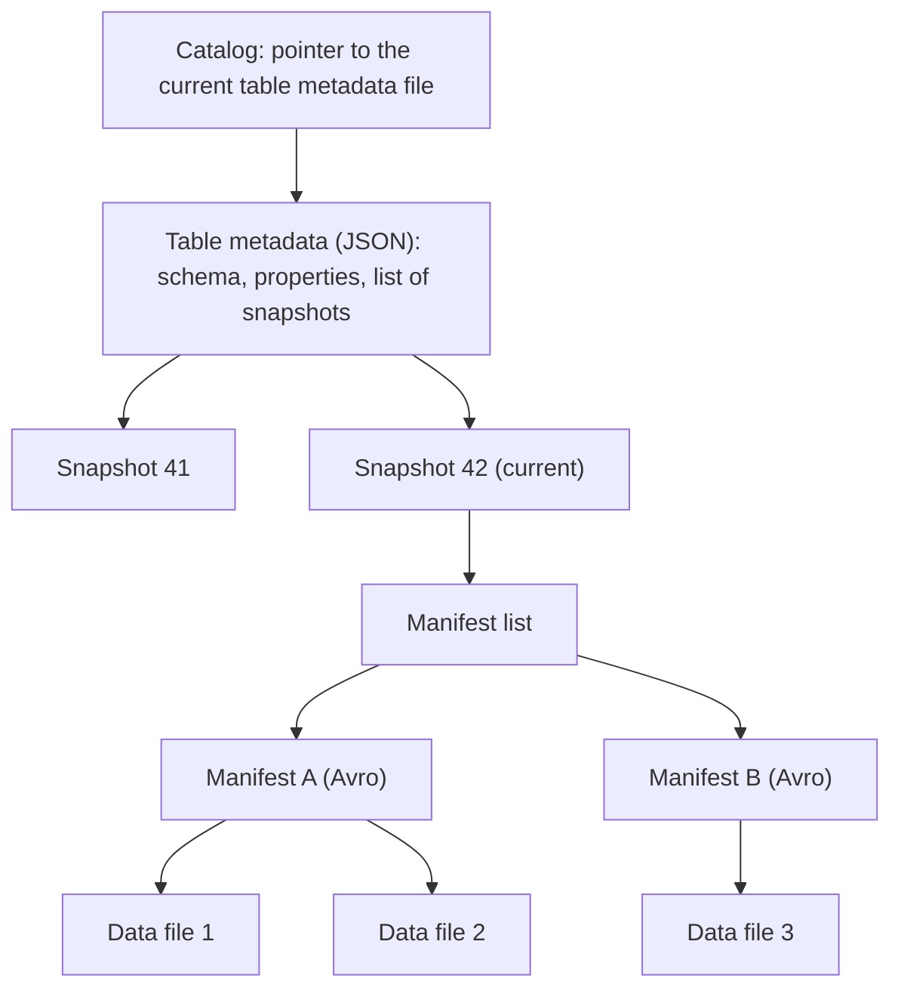

# Background for the Puffin Blob Types Proposal

*A plain-language companion to [Pluggable Puffin Blob Types and a Compaction-Aware Blob Lifecycle](puffin-blob-types-and-compaction.md).*

This backgrounder explains the ideas you need in order to read the proposal. It assumes you know what a database table and a query are. It does not assume you know Parquet, Iceberg, or how query engines avoid reading data.

After reading it, you should be able to follow the proposal's argument and judge its central claim: **an index that a reader ignores can make a query slower, but never wrong.**

Each section stands on its own, so you can start wherever you need to. Terms the proposal uses appear in **bold** where they are introduced, and the [glossary](#glossary) at the end collects them.

**Contents**

* [Data files and Parquet](#data-files-and-parquet)
* [Iceberg tables: metadata, snapshots and manifests](#iceberg-tables-metadata-snapshots-and-manifests)
* [Query planning: skipping files without opening them](#query-planning-skipping-files-without-opening-them)
* [Indexes and filters: answering "definitely not here"](#indexes-and-filters-answering-definitely-not-here)
* [Puffin files and blobs](#puffin-files-and-blobs)
* [Compaction: rewriting files without changing rows](#compaction-rewriting-files-without-changing-rows)
* [Row-level deletes](#row-level-deletes)
* [Why so careful? Writers and readers who never meet](#why-so-careful-writers-and-readers-who-never-meet)
* [Where each idea appears in the proposal](#where-each-idea-appears-in-the-proposal)
* [Glossary](#glossary)

## Data files and Parquet

An Iceberg table stores its rows in ordinary files, usually in object storage such as Amazon S3. These are the table's **data files**, and most of them use the Parquet format.

Parquet stores data by column rather than by row. A query that reads two columns of a fifty-column table reads only those two columns from disk. Within a file, rows are grouped into **row groups** of perhaps a million rows each, and each column of a row group is stored as a **column chunk** divided into **pages**.

At the end of every Parquet file is a **footer**. The footer records the schema, where each column chunk starts, and simple statistics for each chunk, such as the minimum and maximum value. A reader must fetch the footer before it can find anything else in the file. Parquet can also store a Bloom filter for each column chunk (see [Indexes and filters](#indexes-and-filters-answering-definitely-not-here)), but the reader learns where it is only from the footer.

One property matters more than any other for the proposal: **data files are immutable.** Once written, a data file never changes. To change a row, a writer either writes a new file or records the change in a separate file. Because a file never changes, anything computed from it stays true for as long as the file exists.

## Iceberg tables: metadata, snapshots and manifests

Iceberg is a *table format*. It does not store rows itself; it keeps track of which data files make up a table at each point in time. Engines such as Spark, Trino, Flink and Impala read and write the same Iceberg tables.

Iceberg tracks files through a tree of metadata files:

- The **catalog** holds a pointer to the table's current metadata file. A commit succeeds by swapping that pointer atomically, so readers see either the old table or the new one, never a mix.
- The **table metadata** file lists the table's schema, its properties and its snapshots.
- A **snapshot** is the complete state of the table after one commit. Every append, delete or rewrite creates a new snapshot, and old snapshots remain readable until they are expired. That is how Iceberg offers time travel.
- Each snapshot points to a **manifest list**, which points to **manifests**. A manifest is an Avro file with one entry per data file. Each entry records the file's location, its row count, and per-column statistics such as minimum and maximum values.

A data file is **live** in a snapshot if that snapshot's manifests list it. The same data file is usually live in many snapshots, because most commits add files without removing old ones. A file stops being live when a commit removes it, for example a compaction or a delete that rewrites it.

Iceberg has numbered **format versions**. Version 2 added row-level deletes, version 3 added deletion vectors and row identifiers, and version 4 is being designed now.

## Query planning: skipping files without opening them

Before an engine reads any data, it **plans** the query: it decides which data files to open. Planning matters because opening a file in object storage costs a network request and some latency, and a large table can have millions of files.

Consider the query `SELECT * FROM orders WHERE sku = 'ABC-100'`. The planner reads the manifests and, for each data file, compares `'ABC-100'` with the minimum and maximum `sku` recorded for that file. If the value falls outside a file's range, the file cannot contain a match, and the planner skips it. This is called **file skipping** or **pruning**.

Minimum and maximum values work well when similar values sit together, for example dates in a table written in date order. They work poorly in two common cases:

- **Unsorted, high-variety columns.** If every file holds product codes from `AAA-000` to `ZZZ-999`, every file's range contains `'ABC-100'`, and nothing is skipped.
- **Substring and pattern predicates.** A predicate such as `sku LIKE '%100%'` cannot be checked against a minimum and maximum at all.

Indexes fill this gap. An index is extra information about a file that lets the planner skip it in cases where minimum and maximum values cannot.

## Indexes and filters: answering "definitely not here"

The indexes the proposal is mostly about are **filters**. A filter answers one question about a file: "Could this file contain a row matching the predicate?" The answer is either "definitely not" or "maybe."

A **Bloom filter** is the classic example. It is an array of bits, all initially zero. To add a value, you hash it several ways and set the bits those hashes point to. To test a value, you hash it the same ways: if any of its bits is zero, the value was never added. If all its bits are set, the value was *probably* added, but those bits may have been set by other values. That second outcome is a **false positive**: the filter says "maybe" for a file that has no match, and the engine opens the file for nothing. A Bloom filter never gives a false negative.

This one-sided error is what makes filters safe. A false positive costs time; it never drops a row from a result. The proposal calls blobs with this property **exclusion-only**: a reader may use them only to exclude a file (or a part of one), never to conclude that a match exists.

Other kinds of index make stronger claims, and the proposal treats them separately:

| Kind | What the reader may conclude | Example | What goes wrong if it is out of date |
|---|---|---|---|
| **Exclusion-only** | "No row in this part of the file matches." | Bloom filter, min/max range | Nothing; it only gets less selective. |
| **Locating** | "The matching rows are at these positions." | An inverted index from values to row positions | The reader could seek to the wrong rows. |
| **Aggregating** | "This value summarizes the file's rows." | An exact row count or sum | The reader could return a wrong answer without reading the file. |

Some filters need settings that the reader must match exactly. An **n-gram Bloom filter**, for example, splits each string into overlapping pieces of *n* characters (`abc`, `bc-`, `c-1`, and so on) so that it can answer substring predicates. If the filter was built from lower-cased strings, the reader must lower-case its search term the same way. If it doesn't, it looks for pieces that were never added, gets "definitely not," and skips a file that contains the row. The proposal calls these settings a **build configuration**, and much of the design exists to record them so that this mistake cannot happen.

## Puffin files and blobs

**Puffin** is Iceberg's file format for information that is *about* data but is not data. A Puffin file holds a sequence of **blobs**, each an opaque run of bytes, followed by a JSON footer. For each blob, the footer records its **type** (a string), the columns it was computed from, its position in the file, and a free-form map of **properties**.

The Puffin specification defines only two blob types today:

- **`apache-datasketches-theta-v1`**, a sketch that estimates how many distinct values a column has across the whole table. It is listed in table metadata as part of a **statistics file**, and it is tied to one snapshot.
- **`deletion-vector-v1`**, a compact record of which rows of one data file have been deleted (see [Row-level deletes](#row-level-deletes)). It is tied to one data file, not to a snapshot.

There is no registry of other types, no way for an engine to discover code that handles a new type, and no machine-readable description of how a type behaves. A reader that meets a type it does not recognize ignores it. The proposal adds a naming scheme, a registry, a **descriptor** for each type, and a way for each blob to record its build configuration.

The two existing types show the two ways a blob can be bound. A statistics file belongs to a snapshot and becomes useless when the table changes. A deletion vector belongs to a data file and stays valid for as long as that file is live, through any number of later snapshots. The proposal generalizes the second binding to any blob type, calling the result a **data-file-scoped blob**.

## Compaction: rewriting files without changing rows

Tables that receive frequent small writes, such as a stream of events every few seconds, end up with many small data files. Small files are slow to plan and slow to read, so a maintenance job periodically **compacts** the table: it reads many small files and writes their rows into fewer, larger ones. Compaction may also sort or cluster the rows.

A compaction is a **rewrite**. The rows after the commit are the same as before, but they live in new files, and the old files stop being live. The old files are physically deleted later, when the snapshots that still list them expire.

The Iceberg specification says what a rewrite must preserve about rows. It says nothing about what a rewrite should do with other information attached to its input files. In practice, compaction does not carry anything forward: statistics files stay attached to the old snapshot, and an index built for an old file describes a file that is no longer live.

That index is not wrong. Because the file it describes never changed, the index still describes that file correctly. It is simply **orphaned**: no live file needs it. This is the source of the proposal's safety argument. An index tied to an immutable file can lose its usefulness but cannot become false. The proposal then asks each blob type to declare what a rewrite should do with it: **drop** it, **rebuild** it from the new file, **merge** the old blobs into a new one, or **retain** it.

## Row-level deletes

Since data files never change, deleting or updating a single row needs a workaround. Iceberg offers two.

**Copy-on-write** rewrites the whole data file without the deleted row. The old file stops being live and a new one takes its place, exactly as in a compaction. Any index attached to the old file is orphaned.

**Merge-on-read** leaves the data file alone and writes a separate record of what was deleted. Readers combine the two at read time. There are three forms:

- **Position delete files** list deleted rows by data file and row position.
- **Equality delete files** delete every row whose columns equal given values, for example `customer_id = 17`.
- **Deletion vectors**, added in format version 3, store the deleted positions of one data file as a compact bitmap blob in a Puffin file. A data file has at most one deletion vector in a snapshot.

Merge-on-read deletes treat the three kinds of index differently, because the data file itself does not change:

- An **exclusion-only** filter stays correct. Fewer rows can only mean fewer matches, so "definitely not here" remains true. The filter just becomes less selective.
- A **locating** index stays correct, provided the reader removes the deleted positions from what the index returns.
- An **aggregating** index becomes wrong. A row count computed before the delete no longer counts the live rows.

Version 3 also gives every row a **row identifier** (`_row_id`) that writers keep when they move a row to a new file. The proposal's open questions discuss using it to track which rows an index can no longer vouch for.

## Why so careful? Writers and readers who never meet

A reader of the proposal may fairly ask why it needs so much machinery: versions inside type names, descriptors, digests of settings, and rules about when a reader must refuse to use a blob. The answer is that the writer of a blob and its readers may never meet.

A blob may be written today by one engine and read years from now by another. The two may run different library versions, belong to different organizations, and have different ideas about what a type name means. They cannot ask each other anything. Whatever they need to agree on has to be written down, in the blob or somewhere the blob points to.

Most disagreements between them are harmless. If a reader does not recognize a type, it ignores the blob and the query runs a little slower. The dangerous disagreements are the quiet ones, where the reader *thinks* it understands the blob and is wrong. A filter read that way can answer "definitely not here" for a file that holds the row, and the row silently disappears from the result. Nobody gets an error.

Each mechanism in the proposal exists to turn one such quiet disagreement into a loud one, or into a harmless one:

| What could quietly go wrong | What the proposal does |
|---|---|
| The reader's code for a type is older than the writer's, and the format has changed. | The **major version** is part of the type name, so an incompatible change gets a new name that old readers ignore. |
| The reader's code is right, but the blob was built with different settings, such as a different normalization or hash seed. | Each blob records a **digest** of its build configuration, and the reader evaluates the blob under exactly that configuration. |
| The reader cannot find the settings the blob was built with. | The reader must **decline** the blob rather than guess. |
| A compiled-in reader was built against an older description of the type. | The reader carries the descriptor it was built against, and treats any other major version as unknown. |
| An index outlives the file it describes. | Blobs are bound to data files, and a file never changes, so the index can become unused but not false. |

The rule behind all of these is the same: **when a reader is unsure, it declines, and declining only costs time.** The proposal states this as a principle in Section 1.2, explicitness wherever ambiguity is possible.

None of this assumes anyone acts in bad faith. It assumes only that time passes, software changes, and people forget what they decided. Most of the machinery costs very little: a property or two on each blob, and one lookup per distinct configuration. That is cheap insurance against an error that would otherwise show up as missing rows, long after anyone remembers the change that caused it.

## Where each idea appears in the proposal

| Idea in this backgrounder | Where the proposal builds on it |
|---|---|
| Blob types with no registry | Section 4, blob type identifiers and the registry |
| How a type behaves, stated mechanically | Section 5, blob type descriptors |
| Immutable files and deletion vectors' per-file binding | Section 6, data-file-scoped blobs |
| Exclusion-only, locating and aggregating indexes | Section 6.2, what a data-file-scoped blob may assert |
| Settings a reader must match, such as n-gram normalization | Section 7, build configurations |
| Compaction carrying nothing forward | Section 8, compaction semantics |
| Engines finding code for a type at run time | Section 9, Java service-provider interface |
| Writers and readers who never meet; declining instead of guessing | Section 1.2, explicitness; Sections 4.1, 7.1 to 7.4 and 9.4 |
| Older readers ignoring unknown types; merge-on-read deletes; orphan file removal | Section 11, compatibility |
| Table-level indexes tied to snapshots | Section 12, the Iceberg index specification |

## Glossary

| Term | Meaning |
|---|---|
| **Aggregating blob** | A blob that states a value computed over a file's rows, such as a row count. |
| **Blob** | A run of bytes inside a Puffin file, described by an entry in the file's footer. |
| **Bloom filter** | A bit array that answers "definitely not present" or "maybe present" for a value. |
| **Build configuration** | The settings under which a blob was built, such as a hash seed or a normalization rule. |
| **Catalog** | The service that holds the pointer to each table's current metadata file. |
| **Compaction** | A rewrite that combines small data files into larger ones without changing rows. |
| **Copy-on-write** | Deleting or updating rows by rewriting the whole data file. |
| **Data file** | A file, usually Parquet, that holds a table's rows. Immutable once written. |
| **Data-file-scoped blob** | A blob tied to one data file and valid while that file is live. |
| **Decline** | A reader's refusal to use a blob it cannot be sure it understands. Declining costs time, never correctness. |
| **Deletion vector** | A bitmap of the deleted row positions in one data file, stored as a Puffin blob. |
| **Descriptor** | The proposal's machine-readable statement of how a blob type behaves. |
| **Digest** | A short fingerprint computed from a document, used to check that two parties hold exactly the same settings. |
| **Exclusion-only blob** | A blob from which a reader may conclude only that part of a file has no match. |
| **False positive** | A filter answering "maybe" for a file that has no matching row. |
| **File skipping** | Leaving a data file unread because metadata shows it cannot match. |
| **Footer** | Metadata at the end of a Parquet or Puffin file that says where everything else is. |
| **Format version** | A numbered revision of the Iceberg table specification (2, 3, and 4 in design). |
| **Live** | Listed by a snapshot's manifests, and therefore part of the table in that snapshot. |
| **Locating blob** | A blob that states where in a file the matching rows are. |
| **Major version** | The version number inside a blob type's name. It changes only when old readers could misread new blobs. |
| **Manifest** | An Avro file listing data files with their locations and column statistics. |
| **Merge-on-read** | Deleting rows by writing a separate record that readers apply at read time. |
| **N-gram** | A run of *n* consecutive characters taken from a string. |
| **Orphaned** | Describing a file that is no longer live. Not wrong, only unused. |
| **Parquet** | A columnar file format for data, organized into row groups, column chunks and pages. |
| **Planning** | The step before reading in which an engine decides which files to open. |
| **Puffin** | Iceberg's file format for statistics and indexes, holding blobs and a JSON footer. |
| **Rewrite** | A commit that replaces some data files with new ones holding the same rows. |
| **Row group** | A horizontal slice of a Parquet file, typically up to about a million rows. |
| **Snapshot** | The complete state of an Iceberg table after one commit. |
| **Statistics file** | A Puffin file listed in table metadata and tied to one snapshot. |
| **Table metadata** | The JSON file that lists a table's schema, properties and snapshots. |
